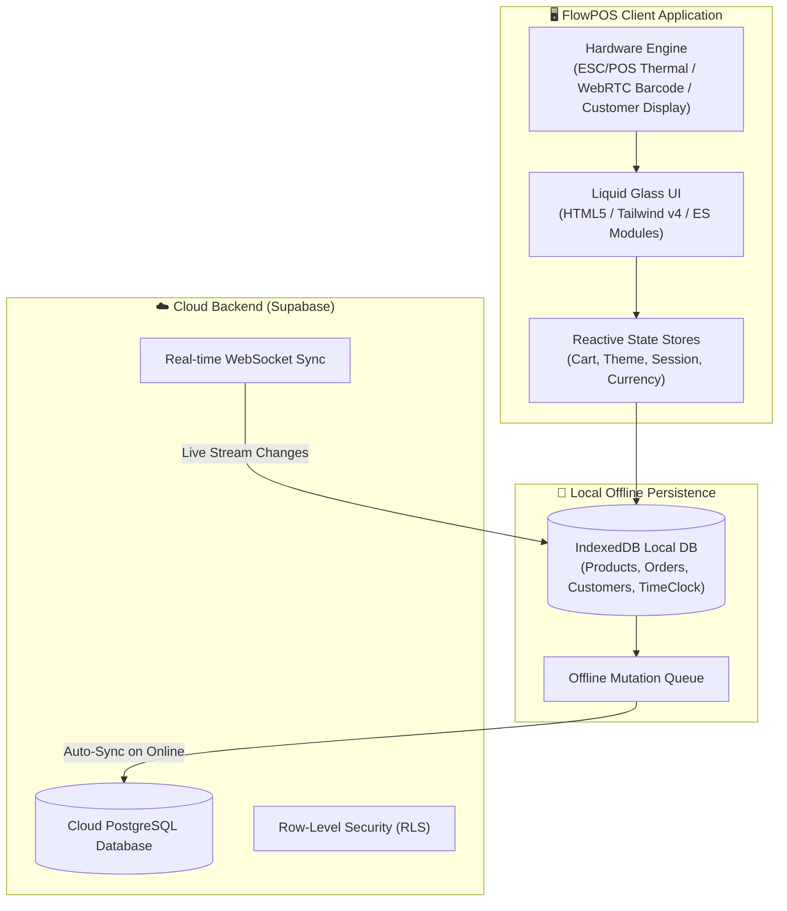

# ⚡ FlowPOS — Next-Gen Offline-First Retail POS & ERP

<p align="center">
  
</p>

<p align="center">
  <b>A commercial-grade, ultra-responsive Retail Point of Sale, Kitchen Display, and Store Management ERP.</b><br/>
  Crafted with Apple-inspired <i>Liquid Glassmorphism</i>, native JavaScript ES modules, Tailwind CSS v4, offline-first IndexedDB persistence, and real-time Supabase Cloud synchronization.
</p>

<p align="center">
  
  
  
  
  
  
</p>

---

## ✨ Key Highlights

- ⚡ **Zero-Framework Speed**: Pure Vanilla JavaScript with reactive stores and modular architecture — instant cashier response with zero framework virtual DOM overhead.
- 💎 **Liquid Glass UI**: Apple-inspired glassmorphic aesthetics with translucent panels, dynamic light/dark/OLED obsidian themes, and 6 vibrant accent palettes.
- 📶 **100% Offline-First**: All inventory reads and sales checkout execute instantly in local IndexedDB. Automatic background sync queues transactions when reconnecting to Supabase.
- 🖨️ **Hardware Integrations**:
  - **Thermal Receipt Printing**: ESC/POS formatting over Web Bluetooth, WebUSB, Network IP (Port 9100), and Browser Print.
  - **Cash Drawer Kick**: Automatic 24V pulse on cash checkout.
  - **Barcode Scanning**: High-speed USB/Bluetooth HID laser guns and WebRTC smartphone camera scanner (`html5-qrcode`).
  - **Barcode Label Studio**: Vector SVG barcode generation (`jsbarcode`) for Avery A4 label sheets and 50x30mm thermal rolls.
  - **Dual-Screen Customer Display**: Real-time customer-facing cart mirror and QR payment display via `BroadcastChannel`.
- 🍳 **Kitchen Display System (KDS)**: Real-time ticket queue with color-coded SLA timers (Green ➔ Amber ➔ Red) and 1-tap ticket bump/recall.
- 📊 **Complete Retail Suite**:
  - Point of Sale & Multi-Tender Checkout (Cash, Card, Split, Gift Cards, Loyalty Points)
  - Catalog Management with Variants & Modifiers
  - Multi-Outlet Stock Transfers & Reordering
  - Purchase Orders & Goods Receiving Cycle
  - Customer CRM, Loyalty Tiers & Stored-Value Gift Cards
  - Staff Time Clock, PIN Locks & Role-Based Access Control (RBAC)
  - Comprehensive Business Analytics & Exportable Reports (CSV/JSON)

---

## 🏗️ System Architecture



---

## 📂 Project Structure

```
flowpos/
├── docs/                      # Technical Documentation & Guides
│   ├── DESIGN_TOKENS.md       # Design system, CSS variables & theming tokens
│   └── USER_GUIDE.md          # Complete enterprise user manual & diagrams
├── public/                    # PWA assets & static files
│   ├── favicon.svg            # FlowPOS vector brand mark
│   ├── manifest.webmanifest   # Progressive Web App manifest
│   ├── sw.js                  # Offline Service Worker cache
│   └── _redirects             # SPA static routing redirects
├── scripts/                   # Tooling & automated test runners
│   └── verify_codebase.mjs    # 7-stage pre-deployment verification suite
├── src/                       # Application Source Code
│   ├── components/            # Reusable UI components (Modals, Cart, Topbar, Sidebar, Toast...)
│   ├── offline/               # IndexedDB layer, mutation queue & sync engine
│   ├── pages/                 # 25 application views (POS, Dashboard, Products, KDS, Settings...)
│   ├── services/              # 19 business domain services (Orders, Payments, Inventory, Printer...)
│   ├── store/                 # Reactive state stores (Cart, Session, Theme, Connectivity)
│   ├── styles/                # Tailwind CSS v4 styling & glassmorphic classes
│   ├── utils/                 # Currency, Barcode, Dates, Icons, Permissions, Security
│   ├── app.js                 # Router & dynamic view container
│   └── main.js                # Application bootstrapper
├── supabase/                  # Cloud PostgreSQL Backend
│   ├── migrations/            # SQL migration schema with RLS policies & atomic RPC
│   └── seed.sql               # Starter sample catalog & outlet dataset
├── index.html                 # Main Single Page Application entry point
├── package.json               # Dependencies & scripts
├── vercel.json                # Vercel cloud deployment config
└── vite.config.js             # Vite build pipeline & vendor chunking
```

---

## 🚀 Quick Start

### 1. Prerequisites
- **Node.js**: v18.0.0 or higher
- **npm** or **pnpm** / **yarn**

### 2. Installation
```bash
# Clone the repository
git clone https://github.com/your-username/flowpos.git
cd flowpos

# Install dependencies
npm install
```

### 3. Environment Configuration (Optional for Cloud Sync)
Create a `.env` file from the provided template:
```bash
cp .env.example .env
```
Populate your Supabase credentials (leave blank for 100% standalone offline mode):
```env
VITE_SUPABASE_URL=https://your-project.supabase.co
VITE_SUPABASE_ANON_KEY=your-anon-key-here
```

### 4. Development Server
```bash
npm run dev
```
Open `http://localhost:5173` in your browser.

---

## 🛠️ Build & Verification

```bash
# Run the 7-Stage Pre-Deployment Verification Suite
npm test

# Build optimized production bundle
npm run build

# Preview production build locally
npm run preview
```

---

## 🗄️ Supabase Cloud Database Setup

To enable multi-terminal real-time sync with Supabase:
1. Create a project at [supabase.com](https://supabase.com).
2. Open the **SQL Editor** in your Supabase Dashboard.
3. Run the schema migrations from `supabase/migrations/20260830_initial_schema.sql`.
4. (Optional) Run `supabase/seed.sql` to populate sample products, categories, customers, and suppliers.
5. In FlowPOS, open **Store Settings ➔ Cloud Sync** and paste your Project URL and Anon Key.

---

## ⌨️ Cashier Keyboard Shortcuts

| Shortcut | Action |
| :--- | :--- |
| `/` or `Ctrl+K` / `Cmd+K` | Focus Search Bar / Global Command Palette |
| `F2` | Open Checkout & Payment Modal |
| `ESC` | Close Active Modal / Dismiss Drawer |
| `Ctrl+Shift+L` / `Cmd+Shift+L` | Instant Screen Lock (PIN Guard) |
| `Ctrl+P` / `Cmd+P` | Reprint Last Thermal Receipt |

---

## 🚢 Deployment

### Deploy to Vercel
FlowPOS includes a pre-configured `vercel.json` with SPA routing and PWA caching headers:
```bash
npm install -g vercel
vercel
```

### Deploy to Netlify / Cloudflare Pages / Static Hosting
Build the static bundle and publish the `dist/` directory:
```bash
npm run build
```
*(The `public/_redirects` file handles client-side SPA routing automatically).*

---

## 📖 Further Documentation

- 📘 [Complete Enterprise User Guide & Architectural Flowcharts](./docs/USER_GUIDE.md)
- 🎨 [Design Tokens & Liquid Glass Styling Guide](./docs/DESIGN_TOKENS.md)

---

## 📄 License

This project is licensed under the **MIT License** — see the [LICENSE](LICENSE) file for details.
