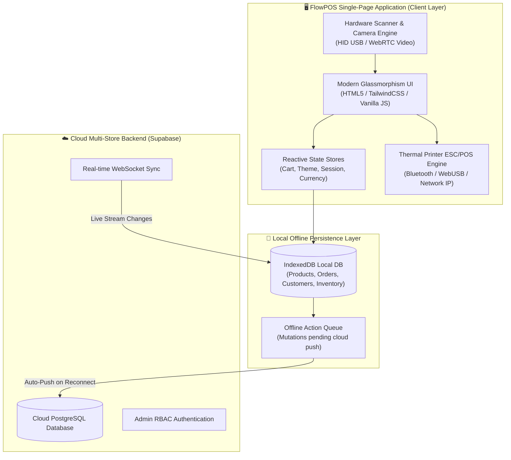
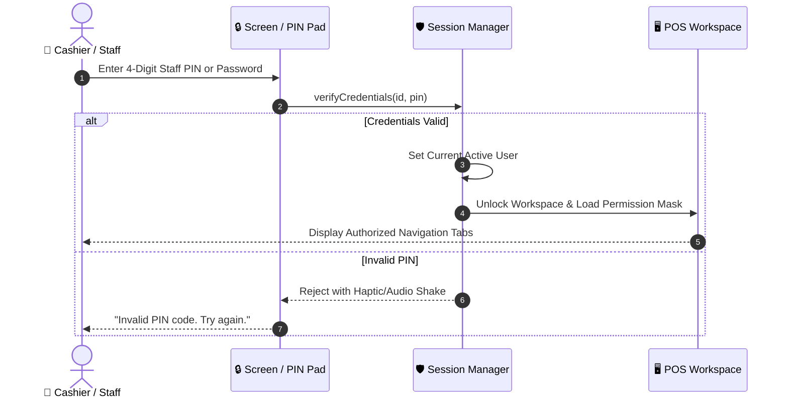
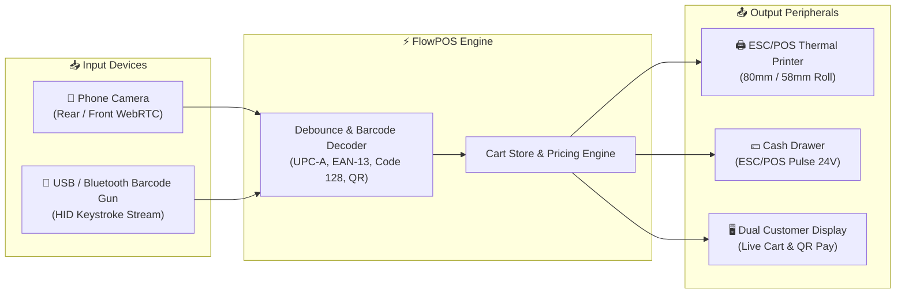
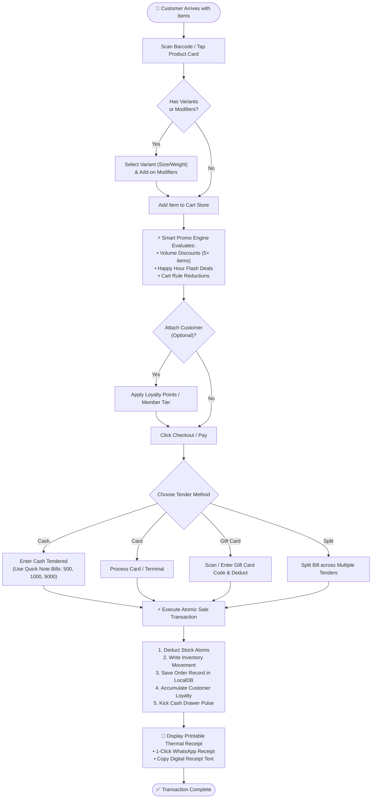
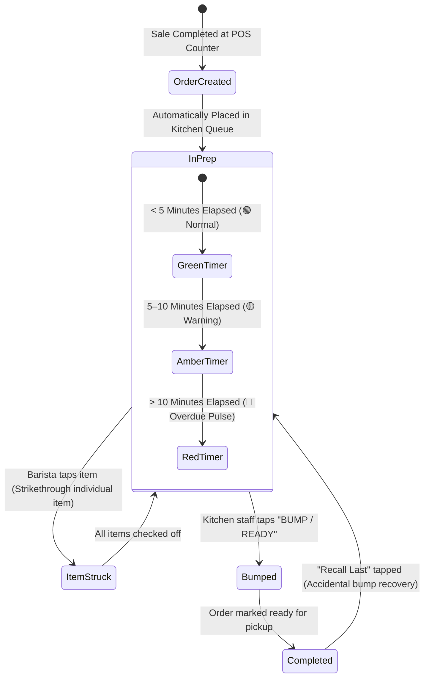
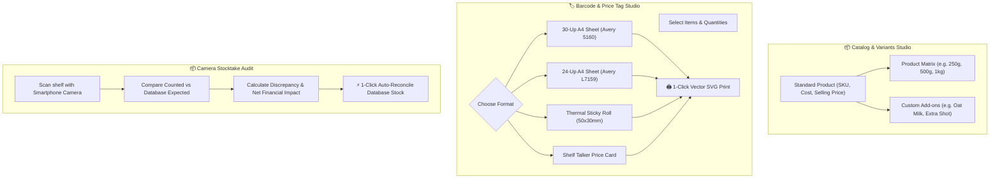
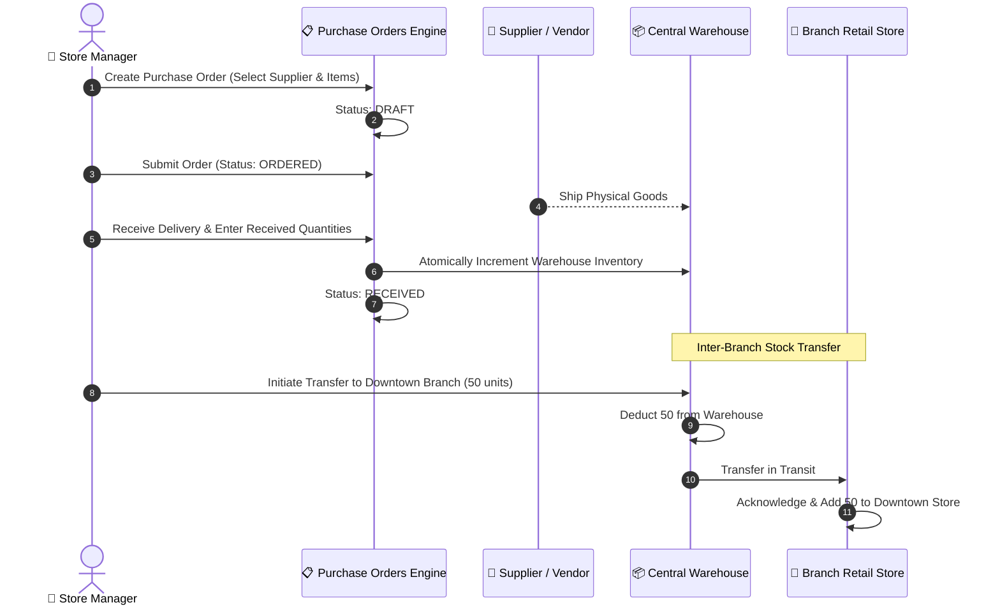
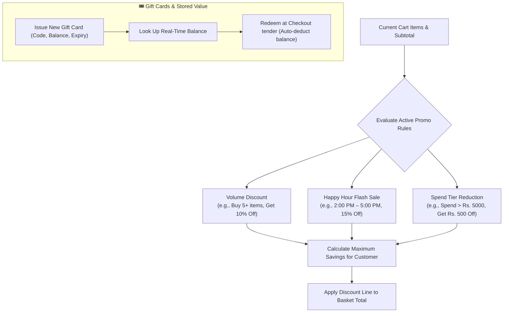
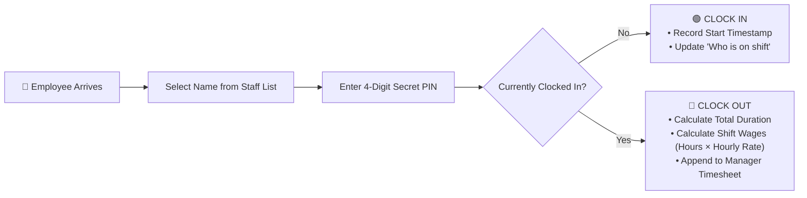
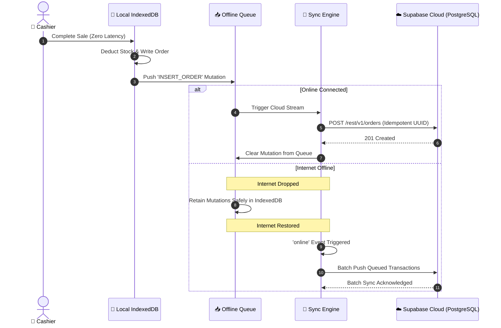

# 📖 FlowPOS — Complete Enterprise User Manual & Architecture Diagrams (A to Z)

**FlowPOS (Liquid Glass Edition)** is a modern, offline-first Point of Sale, Inventory, Kitchen Display, and Retail ERP platform built with native JavaScript, Tailwind CSS, IndexedDB, and Supabase Cloud Sync.

---

# 📑 Table of Contents

1. [System Architecture & Data Flow](#1-system-architecture--data-flow)
2. [Security, Authentication & Role Matrix (RBAC)](#2-security-authentication--role-matrix-rbac)
3. [Hardware & Peripheral Integration Guide](#3-hardware--peripheral-integration-guide)
4. [POS Counter & Checkout Workflow (A to Z)](#4-pos-counter--checkout-workflow-a-to-z)
5. [Kitchen Display System (KDS) & Order Prep](#5-kitchen-display-system-kds--order-prep)
6. [Catalog, Barcode Label Studio & Inventory Audit](#6-catalog-barcode-label-studio--inventory-audit)
7. [Supply Chain, Purchasing & Multi-Outlet Stores](#7-supply-chain-purchasing--multi-outlet-stores)
8. [Marketing, Smart Promotions & Gift Cards](#8-marketing-smart-promotions--gift-cards)
9. [Staff Time Clock & Timesheets](#9-staff-time-clock--timesheets)
10. [Offline-First Sync Engine & Cloud Database](#10-offline-first-sync-engine--cloud-database)
11. [Admin Settings & Customization Guide](#11-admin-settings--customization-guide)

---

# 1. System Architecture & Data Flow

FlowPOS uses an **Offline-First Reactive Architecture**. All reads and writes hit the high-speed local browser database (`IndexedDB`) first, giving sub-millisecond response times with 100% offline capability. Background synchronization engines stream changes to **Supabase (PostgreSQL)** in real time.

---

# 2. Security, Authentication & Role Matrix (RBAC)

FlowPOS protects store financials using role-based access permissions, cashier PIN locks, and manager approval guardrails.

### 👥 Staff Roles & Access Matrix

| Role | Process Sales | Manage Products | View Reports | Manage Inventory | Admin Settings | Override Discounts |
| :--- | :---: | :---: | :---: | :---: | :---: | :---: |
| **Owner / Executive Admin** | ✅ | ✅ | ✅ | ✅ | ✅ | ✅ |
| **Store Manager** | ✅ | ✅ | ✅ | ✅ | ❌ | ✅ |
| **Cashier / Floor Staff** | ✅ | ❌ | ❌ | ❌ | ❌ | 🔒 *(Requires PIN)* |
| **Kitchen / Barista** | ✅ (KDS) | ❌ | ❌ | ❌ | ❌ | ❌ |

---

# 3. Hardware & Peripheral Integration Guide

FlowPOS connects natively to retail peripherals without requiring external proprietary drivers:

### ⚙️ Peripheral Configuration Steps:
1. **Phone Camera Barcode Scanner**:
   - Open **Store Settings ➔ Hardware & Devices**.
   - Set *Default Camera Facing Mode* to **Environment / Back Camera**.
   - Tap **Test Camera** to grant browser camera permissions.
2. **Thermal Receipt Printer (ESC/POS)**:
   - Select connection interface: **Browser Native Print**, **Web Bluetooth**, **WebUSB**, or **Network IP (Port 9100)**.
   - Toggle **Auto-Print on Checkout** and **Kick Cash Drawer**.
3. **Dual-Screen Customer Display**:
   - Click **Launch Screen** to open `#/customer-display` on a second monitor or iPad facing the customer. Live cart totals mirror in real time via `BroadcastChannel`.

---

# 4. POS Counter & Checkout Workflow (A to Z)

---

# 5. Kitchen Display System (KDS) & Order Prep

Designed for fast-casual restaurants, specialty coffee bars, and commercial kitchens:

---

# 6. Catalog, Barcode Label Studio & Inventory Audit

---

# 7. Supply Chain, Purchasing & Multi-Outlet Stores

---

# 8. Marketing, Smart Promotions & Gift Cards

---

# 9. Staff Time Clock & Timesheets

---

# 10. Offline-First Sync Engine & Cloud Database

FlowPOS guarantees zero downtime even if internet access drops during peak rush hours:

---

# 11. Admin Settings & Customization Guide

Admin can configure every facet of FlowPOS under **Store Settings (`#/settings`)**:

### 🎨 1. Appearance & Themes
- **Theme Modes**: *Light Mode*, *Dark Mode (OLED Obsidian)*, or *System Default*.
- **Brand Accent Color Palette**: Choose from 6 curated neon presets (*Electric Blue `#0066CC`*, *Emerald Mint `#059669`*, *Royal Violet `#7c3aed`*, *Rose Pink `#e11d48`*, *Sunset Amber `#d97706`*, *Cyber Teal `#0891b2`*).
- **Typography Font**: *Outfit* (Modern POS), *Inter* (Clean UI), or *Monospace* (Terminal).

### 🏪 2. Store & White-Label Branding
- **Logo Upload**: Upload PNG/JPG brand logo that updates across lock screen, receipts, and dual screens.
- **Store Legal Profile**: Business name, tax registration number, phone, email, and address.
- **Thermal Receipt Customization**: Custom header branding and footer return policies.

### 💰 3. Currency, Tax & Pricing Engine
- **Multi-Currency**: Select base currency (*LKR, USD, EUR, GBP, AUD, CAD, INR, AED, SGD, JPY*).
- **Symbol & Formatting**: Set prefix/suffix position (e.g. `Rs. 500` vs `500 LKR`) and decimal places.
- **Tax Rules**: Configure default tax percentage, Tax Label (*VAT, GST, Sales Tax*), and tax-inclusive pricing.

### ⚡ 4. POS Register & Checkout Rules
- **Quick Cash Bill Presets**: Configure tender buttons (e.g. `500, 1000, 2000, 5000` or `5, 10, 20, 50, 100`).
- **Loyalty Program**: Set spend per 1 point (default `100`) and point cash redemption value (`Rs. 1.00`).
- **Manager Security Guardrails**: Require Manager PIN for order discounts > 20% and customer refunds.
- **Tipping**: Toggle customer tip prompt on checkout.

### 🖨️ 5. Hardware & Diagnostics
- **Live Test Bar**: 1-click tests to test camera scanner, test thermal print, kick cash drawer, and test customer screen.
- **Scanner HID latency**: Configure millisecond debounce threshold (30ms–100ms) for high-speed laser scanners.

### ☁️ 6. Cloud Multi-Store & Backup
- **Supabase Cloud Sync**: Input project URL and public Anon key for multi-terminal sync.
- **1-Click Full Backup**: Download JSON backup of all catalog items, customers, orders, and registers.
- **Demo Data Generator**: 1-click starter catalog population.

---

*FlowPOS — Built for Speed, Reliability, and Elegance.*
